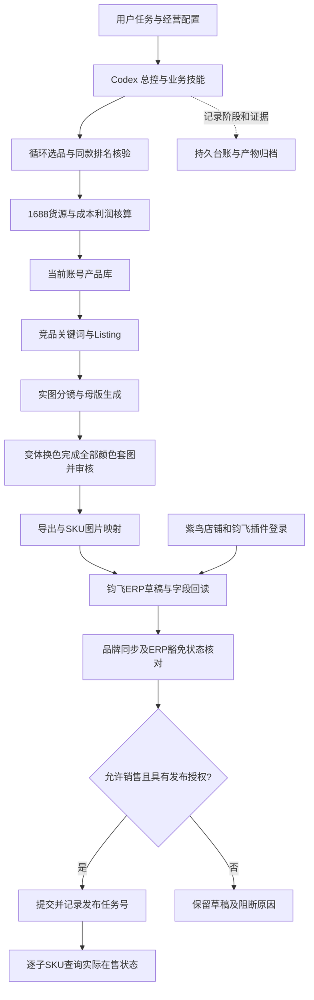

# 亚马逊自动选品、Listing、作图与上架实现说明

更新时间：2026-11-06（北京时间）  
适用项目：`C:/Users/Administrator/Documents/ChatGPT/亚马逊Listing编辑作图`

## 1. 这套系统如何工作

这套项目由 **Codex 总控、业务技能、浏览器执行、产品工作台、模型服务、任务台账和钧飞 ERP** 共同完成一条生产链：

> 循环发现商品 → 筛选同款及排名 → 匹配 1688 货源 → 算成本利润 → 入产品库 → 研究关键词 → 写 Listing → 完成一个颜色的整套母版 → 用变体换色完成其余颜色的完整套图 → 导出 → 保存 ERP 草稿 → 满足条件后发布 → 核实全部子 SKU 在售。

Codex 负责理解任务、读取当前规则、调用模块、检查真实结果并保存证据。文本模型负责基于资料写文案，图片模型负责依据参考图制作图片；浏览器负责登录、采集和页面操作；台账负责记录每款进行到哪一步，以及失败后如何恢复。

**全自动选品环节使用循环选品技能 `cyclic-product-discovery`，由 `amazon-full-pipeline` 总控技能调度。** 循环选品技能负责持续追踪商品、Seller 和店铺并发现下一轮候选，按当前配置完成同款排名、货源和利润核验后，再交给后续 Listing、作图及刊登流程。

**当前实现是 Codex 驱动、多个模块协作的自动化流程，完整无人值守执行器仍未接通。** 部分真实产品已经完成套图、导出及 ERP 草稿保存，但这不能证明整套系统已经支持一键自动上架。

本次编写文档时运行了 `status`、`profiles` 和 `doctor`。`doctor` 返回：

```json
{
  "ready_for_unattended_run": false,
  "issues": ["刊登页面适配未完成；不可运行保存/发布"],
  "note": "当前为Codex驱动总控；各阶段尚未全部接成无人值守执行器"
}
```

这里的页面适配问题针对通用刊登入口。已有单款草稿操作和受限适配器的成功记录，不能替代通用执行器校准。

## 2. 各部分分别做什么

| 组成 | 作用 | 当前边界 |
| --- | --- | --- |
| Codex 总控 | 读取需求，按固定顺序调度，判断证据、异常和下一步 | 当前仍承担跨模块衔接和浏览器判断 |
| 业务技能 | 规定选品、找货源、文案、图片及刊登操作方法 | 技能是操作规则，不等于常驻运行服务 |
| 循环选品技能 cyclic-product-discovery | 执行标题首句搜索、追踪 Seller 和店铺、生成下一轮关键词，并按规则核验同款排名、货源及利润 | 由 Codex 调用，发现数量与核验通过的入围数量分别记录 |
| EGO 专属工作区 | 操作 Amazon、1688、卖家精灵及钧飞 ERP 编辑页 | 复用配置中的专属空间，不自动回退 Edge |
| 紫鸟 CLI | 打开目标店铺、确认站点，并在紫鸟内完成钧飞插件登录 | 与 EGO 分别保持登录，不复制 Cookie |
| Listing 工作台 | 保存产品事实、原图、变体、研究、文案、图片任务及审核状态 | 按员工账号隔离，只操作明确账号及产品 ID |
| 文本模型 | 基于真实资料生成标题、五点、描述和后台词 | 当前文案模块对接 DeepSeek；不能补造商品事实 |
| 图片服务 | 依据实图生成母版、套图及必要返修 | 当前配置启用 Codex Tools 订阅通道，仍受额度和实际服务状态约束 |
| CLI 流水线台账 | 保存阶段、配置快照、领取 token、尝试次数和证据 | 与网页任务中心的账号台账尚未自动同步 |
| 钧飞 ERP | 保存刊登资料、申请豁免、提交并反馈结果 | 完整发布和逐子 SKU 在售查询尚未统一自动化 |



上图表示业务链路；部分节点目前由 Codex 调用脚本或操作页面完成，不能把流程图理解为所有节点均已自动接线。

## 3. 当前经营参数

以下取自本次读取的 `automation/config.json`。用户最新指令优先，后续运行应重新读取配置，不沿用本文的静态数值。

| 项目 | 当前配置 |
| --- | --- |
| 选品站点、目标 | 美国站 US，目标 30 款 |
| 发现方式 | 标题首句 → 商品 → Seller → 店铺其他商品 → 新关键词循环 |
| 日期窗口 | 近 30 天；使用卖家精灵商品上架日期口径 |
| 来源商品品牌 | Amazon 商品页品牌明确为 Generic |
| 排名要求 | 同款任意卖家的商品有数值销售排名，无额外排名高低阈值 |
| 店铺配额 | 同一来源店铺每日最多 2 款，并进行跨批次排重 |
| 货源 | 1688，优先公开销量较高且规格匹配的货源 |
| 变体 | 先完整采集实际观察到的颜色、尺码和子 ASIN；无货源覆盖的子体从本次刊登剔除并留原因 |
| 图片 | 目标每套 7 张，当前目标输出 1600×1600 |
| 图片预算 | 默认每款 ¥5、每日 ¥200；产品 IMP-US-B0HQ6T361R 单独授权 ¥8 |
| 图片通道 | Codex Tools 本机服务，订阅额度模式；不把订阅调用记为零费用或已结算 |
| 当前默认刊登档案 | test-wyj-us：示例店铺-美国 / US |
| 刊登数量、处理时间 | 数量 88、处理 3 天；数量是刊登设置，不是供应商实际库存证明 |
| 运费模板 | Migrated Template，仍须核对目标店铺实际适用性 |
| 默认刊登模式 | draft，即保存草稿；正式发布按具体任务的明确授权执行 |
| 定时运行 | 未启用，execution.scheduled=false |

来源商品的 Generic 筛选与目标店铺的刊登品牌选择是两项独立规则。刊登时应同步目标店铺品牌并选择适用于本品的品牌，不能固定套用 Generic。

当前用户规则不进行专利检索，记录应写“未检索”，不能写“无专利”或“专利检查通过”。供应商页面资料和图片按用户默认采用规则处理，保留来源；不使用竞品图片或带未授权品牌标识的素材。

## 4. 全自动选品：使用循环选品技能

选品入口固定使用[循环选品技能 cyclic-product-discovery](C:/Users/Administrator/.codex/skills/cyclic-product-discovery/SKILL.md)，执行前读取该技能与当前经营配置。这里的“全自动选品”指由 Codex 按该技能连续推进发现与核验；网页任务中心尚未接入独立的无人值守选品执行器。

技能执行分为两条相互衔接的链路：

```text
循环发现：标题首句/种子词 → Amazon搜索 → 商品 → Seller → 店铺商品列表
          → 其他商品 → 新标题首句 → 下一轮Amazon搜索

入围核验：候选登记 → 当前选品规则与排重 → 标题首句搜索同款
          → 同款任意卖家有数值销售排名 → 1688同款货源
          → 成本利润核算 → 有利润才入围 → 采集到当前账号产品库
```

循环中遇到缺货源、规格不符、关键成本缺失或利润不为正的商品，保存原因并继续其他候选。达到本次目标数量或技能规定的停止条件后，汇总发现数量、核验通过数量、实际入库数量及阻断项，不能把搜索到的商品都计入已选款数。

### 4.1 用商品与卖家关系持续发现新商品

选品采用循环关联挖掘：

1. 从种子商品或关键词开始，提取标题首句中的产品类型短语。
2. 在 Amazon 搜索，查看商品、品牌、卖家及可见的排名信息。
3. 进入 Seller 对应的商品列表，从店铺其他商品中发现候选。
4. 从新商品的标题提取下一轮关键词，继续搜索和追踪卖家。
5. 保存商品、关键词、店铺及它们之间的来源链。

同行店铺长期保存到 `outputs/同行店铺记忆库.csv`，按站点和 Seller ID 去重；已选商品维护在 `outputs/fbm-selected-products.csv`。收藏店铺只表示可以复访，下次选品仍须重新核对日期、品牌、排名、货源、利润及配额。

### 4.2 候选通过哪些检查才能入围

候选先登记到任务台账，再依据当前任务策略核验：

- 来源站点和商品身份正确，卖家资料及 FBM 履约按实际页面留证。
- 日期满足近 30 天口径。卖家精灵商品上架日期不能冒充该卖家独立上架日期，店铺“最新上架”排序也不能代替日期证据。
- Amazon 品牌字段明确为 Generic，不能用空白品牌或店铺名代替。
- 已按标题首句实际搜索，并确认具有数值排名的商品确为同款。
- 通过排重和来源店铺当日配额检查。
- 找到匹配货源、取得核算所需成本资料并算出正利润后，才进入用户要求的产品库审核名单。

候选自身或其他卖家的同款 ASIN 有排名均可；相似商品排名、搜索位置、广告位置和销量估算不能代替同款数值销售排名。

**当前执行方式：** 由 Codex 按 `cyclic-product-discovery` 循环选品技能调用浏览器脚本、检查页面并保存证据；入围后交给总控技能继续研究、文案、图片和刊登。网页任务中心还没有自动从全网发现商品并连续执行到上架的浏览器循环。

## 5. 找货源与算利润是怎样实现的

### 5.1 货源采集

确认同款排名后，优先使用 Amazon 增强面板中的钧飞“1688货源”入口；该入口不可用时，按既有备用方法在专属 1688 图片搜索页面使用主图搜款。

货源按公开销量优先比较，打开详情核对目标颜色、尺码、材质、件数和结构，保存：

| 信息 | 记录要求 |
| --- | --- |
| 供应商与链接 | 具体 offer 链接、商品身份、采集时间、公开销量原文及口径 |
| 采购报价 | 目标规格价格、起订量、国内运费；不拿起步价冒充目标规格成交价 |
| 重量尺寸 | 包装毛重和包装长宽高，区分产品净重、产品尺寸与包装数据 |
| 变体 | 实际观察到的颜色、尺码及具体组合，保留原始采集与排除清单 |
| 图片 | 对应商品与颜色的参考图、来源地址及本地原件备份 |

每款可使用一个经核实的供应商，不要求逐颜色另找一家。货源页面没有提供的字段留空；缺关键核算数据则阻断该款并继续其他商品。

已观察到颜色和尺码选项，不代表所有组合都有货。工作台会比较采集子体与货源可见选项及已有具体组合；覆盖检查也不能作为实际库存保证。

### 5.2 成本和售价公式

当前配置采用报价成本加价法：

```text
计费重量kg = max(包装毛重kg, 包装长cm × 包装宽cm × 包装高cm ÷ 8000)

运费RMB = 计费重量kg × 渠道每kg报价 + 处理费 + 附加费

总成本RMB = 采购成本 + 运费 + 其他成本

公式售价USD = 总成本RMB × 1.5 ÷ [6.8 × (1 - 0.15)]

利润RMB = 核算售价USD × 6.8 × (1 - 0.15) - 总成本RMB
```

售价按配置向上取整到美分。国内运费等应计入相应成本，避免漏算或重复计算；物流报价必须匹配商品类别、重量和尺寸限制。

这里的 50% 是对成本加价，不是销售净利率。核算还要保存同款市场售价，分别判断公式售价是否具有市场可行性，以及采用市场售价时利润是否仍为正。不能因为公式主动加价后利润为正，就认定市场已经接受该价格。

配置中把部分未确认附加费和其他费用按零处理的基础情景，仅用于草稿估价。正式发布前需要核实适用费用及渠道限制，不能把估价假设当成实际费用证明。

**当前执行方式：** 工作台能解析已有货源资料，生产任务能只读核查已有链接或部分候选详情；登录页和动态页面仍需要浏览器处理。同款认定、正式采用货源及关键成本核实尚未完全自动化。

## 6. Listing 是怎样自动写出来的

文案流程把“本品事实”和“竞品表达”分开使用：

1. 从当前账号产品库取得本品材质、尺寸、包装、颜色、尺码、用途及已核实卖点。
2. 输入已核验的竞品 ASIN，最多 5 个，不足 5 个按实际数量使用。
3. 读取可用的竞品正文、关键词或卖家精灵数据，保存来源和采集结果。
4. 将真实关键词分配到标题、五点、描述和后台搜索词。
5. 由当前账号配置的文本模型生成文案，并检查事实、语言、关键词覆盖及字段格式。
6. 保存文案和历史版本，等待审核；采用新稿或更新关键资料后重新检查。

竞品可以提供搜索词和表达思路，不能提供本品的材质比例、认证、重量、性能或包装数量。未获取搜索量和评论样本时不得生成虚假指标。

供应商及第三方品牌词会纳入排除检查，不能混进标题、五点、描述、后台词和图中文字。后台词按 UTF-8 字节检查；部分适配器采用 249 字节留余量，具体字段限制以目标站点及实际适配器为准。

**当前执行方式：** 工作台具备真实文案生成、保存和检查能力。任务中心可在明确启用自动研究、自动文案后调用对应模块；自动文案先独立保存草稿，采用和审核仍是明确的后续动作，不能把模型返回成功记成审核通过。

## 7. 图片是怎样自动做出来的

### 7.1 从实物资料到七图母版

图片输入包括供应商产品实图、颜色参考、细节图及同一版本的产品事实。视觉策划根据这些资料生成每个图位的买家问题、卖点、构图和图中文字，再编译成具体生成指令。

默认每套 7 张，具体分镜按商品资料决定，通常覆盖主图、卖点、细节、使用场景、尺寸或选购信息。没有尺寸、性能或包装证据时应调整图位内容，不能为了凑满七张而编造。

先制作并选定一个颜色的完整七图母版，再使用工作台的**“变体换色”**功能，按实际颜色参考生成其余可刊登颜色的完整七图套图，做完整个产品的图片。

### 7.2 用变体换色做完整个产品图

按用户确认的顺序执行：

1. **完成首色母版：** 先完成一个颜色的全部 7 张图片，核对商品、图位、文字和构图，选定用于后续换色的整套母版。
2. **确定目标颜色：** 读取本产品实际采集且有货源覆盖的可刊登颜色，为每个目标颜色关联对应参考图；没有货源的颜色按既定规则剔除并保留原因。
3. **执行变体换色：** 将首色整套母版交给“变体换色”，逐目标颜色生成对应的全部 7 张图片，保留整套版式和图位顺序。主图、附图及图中出现的商品细节都要与目标颜色一致。
4. **检查并定点返修：** 逐颜色、逐图位核对颜色、结构、配件、纹理、印花和文字。发现问题只处理对应颜色及图位，查询并复用已完成任务，避免重复生成整套。
5. **绑定全部子体：** 将每个颜色的主图及附图绑定到该颜色下实际采集的尺码子 SKU；同款同色、仅尺码不同的子体可共用该色套图，不扩造未采集组合。
6. **整款完整后导出：** 确认所有拟刊登颜色均有完整套图、实际文件和正确子 SKU 映射，且达到要求的审核状态，再进入导出与刊登。

当前每色 7 张时，整款应有的图片数量为“可刊登颜色数 × 7”，首色母版包含在总数中。例如 4 个颜色应完成 28 张，不能只生成其余颜色的主图就记作整款图片完成。缺图或换色失败的产品保留未完成原因，继续处理其他可执行任务。

换色必须以真实颜色参考为依据，保持商品结构、配件、纹理及印花等身份特征；不适合直接换色的材质或图案，应使用对应实图或重新制作相应图位。参考不足时保留待补项，不凭颜色名称臆造效果。

本节明确生产操作顺序，不表示网页任务中心已接通自动触发整款变体换色的执行器，也不代表本次已提交新的生图请求。

### 7.3 当前图片通道与尺寸

当前配置启用 Codex Tools 订阅模式，经本机图片接口调用 `gpt-image-2`。项目还保留 APIMart 和 OpenAI 兼容图片适配能力，具体通道由当前账号设置和经营配置共同决定，不能为重试历史失败而擅自切换并重新提交。

2026-11-06 的验收记录确认：修复后的正式服务通过工作台生产生图模块完成过一次真实参考图请求，并保存了结果。该验收覆盖接口和生产模块，不等于浏览器按钮回归或整套图片审核通过。

当前请求及交付目标为 **1600×1600**。若服务实际返回其他尺寸，系统保留原图并等比适配，同时记录原始宽高、转换方法及是否放大。已有验收样本原图为 1254×1254，适配后为 1600×1600；这不能写成原生 1600 像素细节。

### 7.4 费用与任务恢复

- 提交前查同一产品、图位已有任务，保存提交记录，再调用服务。
- 收到外部任务号后持久保存，等待和恢复时查询原任务。
- 付费通道按核实报价及预算预留执行，账单核对后结算；未知结果继续保留。
- 订阅通道单独记录请求和额度依据，不冒充按次零费用或账单已结清。
- 整套重做、换色和返修都要检查已有记录及对应授权额度。

CLI 与网页图片费用台账尚未同步，读图、分镜、文本及质检费用也没有形成统一完整的累计扣减控制。因此不能承诺全流程费用已经硬性封顶。

### 7.5 图片完成的标准

整款图片完成要求首色母版及通过变体换色制作的其余颜色套图全部齐全，并检查商品外形、颜色、配件、材质表现、文字、缺图、尺寸和子 SKU 对应关系。模型质检、Codex 目视检查与人工审核分别留记录，不代替填写人工审核标志。

**真实案例：** 项目已有一款开衫完成 4 色各 7 张、合计 28 张套图，并保存到包含 16 个子款的钧飞草稿。该批历史成图为 2048×2048；新的目标尺寸为 1600×1600。草稿和图片记录不代表已经发布或在售。

## 8. 导出与上架怎样衔接

### 8.1 导出交付包

工作台按当前账号和产品导出文案、图片及变体映射，并核对每个颜色的图位、每个子 SKU 的主图和附图、缺图和排除清单，记录文件哈希。

导出 ZIP 与旧刊登准备脚本的输入格式并非完全兼容，多颜色转换也存在限制；需要真实字段转换和回读，不能改文件扩展名后直接交给刊登程序。

### 8.2 先完成紫鸟中的两项登录

钧飞 ERP 使用已确认的双浏览器顺序：

1. 用紫鸟 CLI 精确打开或复用对应店铺，确认店铺登录及站点。
2. 在该紫鸟店铺浏览器内打开钧飞插件，单独确认插件已登录。
3. 两项登录就绪后，再操作另一浏览器 EGO 中的 ERP 编辑页。
4. 核对 ERP 当前选中的店铺和站点与紫鸟目标一致。

紫鸟窗口名称不能代替 ERP 店铺映射，两边登录状态分别维护。

### 8.3 同步品牌、申请豁免、保存并回读

在 EGO 的 ERP 编辑页同步目标店铺品牌，选择适用于本品的品牌，记录选择依据。随后按同一产品、店铺、站点、品牌及商品类型申请商品编码豁免；已有申请先查询，结果未知时先对账。

申请后继续完善文案、图片、可刊登的颜色尺码、价格、类目及必填属性，保存并重新打开核对。特别检查材质比例、包装毛重、包装长宽高和件数，不能把 ERP 预填值当作本品事实。

Listing 完善后，回查 ERP 中同一身份的豁免状态，实际显示 **“允许销售”**，且其他检查通过并已有发布授权，才进入发布。Seller Central 的历史豁免证据不能代替本次 ERP 状态。

旧适配器存在品牌仅允许 Generic 等限制时，应先修改并验证实际行为，不能伪造授权字段或修改校准标志来通过检查。

### 8.4 从提交追到在售

| 状态 | 可以说明什么 |
| --- | --- |
| ERP 草稿已保存 | 资料已保存，还需回读核对 |
| ERP 显示允许销售 | 本次豁免状态满足对应门槛，仍需其他检查和发布授权 |
| 发布任务已创建 | ERP 接受了提交，需保存任务号并查询结果 |
| 亚马逊处理失败 | 保存错误码和父子 SKU 缺项，修复后按原记录恢复 |
| ASIN 已创建 | 已获得商品标识，还需要核实可售状态 |
| 全部拟刊登子 SKU 在线 | 满足最终在售核对条件后，才能完成 verify |

当前默认是草稿模式。完整 ERP 发布和逐子 SKU 在售查询仍未统一接入网页任务中心，不能把“上架准备完成”写成“亚马逊在售”。

## 9. 如何防止重复付费、重复提交和中断丢失

CLI 的八个固定阶段是：

```text
selection → sourcing → research → listing → images → export → publish → verify
```

选品入围之前就要进行货源和利润预核验；正式 sourcing 阶段继续整理、复核货源与变体证据。阶段名称不代表可以在选品时跳过利润门槛。

每款有永久任务 ID，按站点及来源商品 ID 排重。创建时保存配置快照，因此修改全局配置不会自动改变历史任务；旧的日期、排名、专利或品牌策略应明确重检并留历史。

| 状态或操作 | 含义与处理 |
| --- | --- |
| ready | 可以领取下一阶段，不表示已执行 |
| claim / running | 领取后获得 token，执行中断也不自动重发 |
| blocked | 缺事实、资料或不满足规则，保存原因并继续其他产品 |
| uncertain | 请求可能已提交，先核查服务商或 ERP 实际结果 |
| finish | 使用原 token 提交真实检查、来源和产物，校验后推进阶段 |
| resume | 只有确认未发生外部提交并保存对账依据后，才恢复执行 |
| done | 全部阶段完成；最终需要全部拟刊登子 SKU 在线证据 |

证据保存来源 URL、读取时间、页面原文、判断、真实产物路径、哈希和外部任务号。检查项填 true 或文件哈希匹配，只能证明记录结构及文件一致性，不能单独证明事实或图片质量。

当前每阶段最多尝试 2 次，达到上限先诊断。不能新建产品 ID、换脚本路径或重置状态来绕过未知提交记录。网页任务中心另有自己的游标、快照和中断核对机制，不应直接套用 CLI 状态进行修改。

## 10. 入口、文件及启动方法

### 10.1 项目文件地图

以下路径均位于项目根目录中：

```text
亚马逊Listing编辑作图/
├─ AGENTS.md                         项目执行约束
├─ automation/
│  ├─ README.md                      固定流程、历史变更与运行说明
│  ├─ config.json                    经营参数、浏览器及店铺配置
│  ├─ pipeline.py                    CLI台账、阶段证据、预算登记
│  ├─ ego_browser.py                 EGO官方运行时统一入口
│  └─ data/                          CLI记录、操作回执和阶段证据
├─ listing-workbench/
│  ├─ AGENT-CENTER.md                网页任务中心能力及边界
│  ├─ server.py                      本地工作台服务
│  ├─ agent_center.py                固定工具循环与账号任务
│  ├─ agent_sourcing.py              已有货源的公开读取与比较
│  ├─ supplier_variants.py           已采集子体的货源覆盖检查
│  ├─ provider.py                    文案生成及字段处理
│  ├─ ivyea_pipeline.py              图片识别、策划及提示词编译
│  ├─ visual_studio.py               视觉生产任务
│  ├─ colour_sets.py                 多颜色套图
│  └─ delivery_export.py             交付包导出
├─ junfei-publisher/
│  ├─ recipe.json                    通用页面规则，目前未校准
│  ├─ listing.mjs                    本地预检及历史刊登入口
│  ├─ ego-existing-draft.mjs          已有草稿的受限文案保存
│  └─ source-window-fix/             钧飞货源入口的窗口归属修复
└─ outputs/                          研究、图片、交付包及核验记录
```

### 10.2 运行前检查

在项目根目录使用 PowerShell：

```powershell
py -3 -X utf8 automation/pipeline.py status
py -3 -X utf8 automation/pipeline.py profiles
py -3 -X utf8 automation/pipeline.py doctor
py -3 -X utf8 automation/pipeline.py readiness
```

这些命令用于查台账、档案和实现缺口，不会自行完成选品、生图或点击发布。即使未来 doctor 不再报告配置问题，也仍要核实执行器是否已接通和真实验收。

工作台源码服务入口：在 `listing-workbench` 目录运行 `py -3 server.py`，默认访问 `http://127.0.0.1:18765`。已有实例运行时先复用并核对版本，不重复启动；具体桌面版和便携版部署状态以实际进程及发行记录为准。

进入工作台后使用当前账号的店铺档案和明确产品 ID。准备检查只检查现有资料；生产模式可执行已接入的货源只读核查、研究、文案及导出等工具。网页关闭后工作线程可随服务继续，服务进程退出后不能承诺持续执行。

### 10.3 浏览器与凭据

当前配置的选品空间为 TaskSpace 4：`Amazon-cyclic30-20261106`。每次实际操作前须读取最新配置和 EGO 技能，使用官方运行时及统一入口，不操作用户空间 0，不对整个浏览器发送原生鼠标键盘输入。

2026-11-06 已修复并实测钧飞“1688货源”入口的新标签归属，使其跟随来源窗口并后台打开。该结论只覆盖此入口，不保证卖家精灵等其他插件不会跨工作区；TaskSpace 或 CDP windowId 也不能单独证明系统窗口完全隔离。用户接管或反馈干扰时停止页面操作。

密钥保留在账号凭据机制中，不写入配置、本文或任务证据。旧版说明与当前配置冲突时，应按最新指令、配置和实际运行版本核实，不能直接套用历史操作。

## 11. 当前做到了哪里，还缺哪些连接

| 环节 | 已有能力和证据 | 距离无人值守还缺什么 |
| --- | --- | --- |
| 循环选品 | 有技能、专属浏览器脚本、长期店铺池和排重表 | 持续候选队列、稳定页面采集及证据判断的统一执行器 |
| 货源利润 | 有浏览器采集、公开详情核查、规格覆盖与报价核算 | 搜索、采用货源和完整成本校验的自动衔接 |
| 关键词文案 | 有真实数据读取、模型生成、版本与来源检查 | 从已通过候选到已审核文案的统一调度和完整费用跟踪 |
| 图片生产 | 有分镜、真实生图、颜色套图、任务恢复和本地输出 | 与全流程队列衔接，以及完整费用及审核控制 |
| 导出 | 有真实 ZIP、图位及子 SKU 映射检查 | 工作台交付包与刊登输入的稳定转换 |
| ERP 草稿 | 有受限执行器和真实草稿保存、回读记录 | 通用类目、属性、变体、图片及品牌豁免适配 |
| 正式发布 | 有业务规程及历史真实提交反馈记录 | 稳定的发布执行器、任务回执和错误恢复 |
| 在售核对 | 规则要求全部子 SKU 在线才完成 | 统一的逐 SKU 实际状态查询与持续跟踪 |
| 总体运行 | 有持久台账、配置快照、账号隔离和防重发 | CLI与网页台账同步、全链路调度和故障恢复验收 |

若要实现真正“一次下任务，自动跑到结果”，建议按上述缺口依次补齐：先统一产品身份和两套台账，再衔接选品与成本证据、文案图片生产及费用，随后完成 ERP 双浏览器准备、品牌豁免和页面适配，最后接入发布与在售核对。以小批量覆盖成功、资料缺失、超时未知、额度不足和页面变化，再扩大批量。

登录或验证码无法自动完成、事实缺失、人工审核尚未完成等情况应明确转为待处理任务，其余商品继续推进。用户已授权的正常步骤直接执行；只有缺少必要参数或授权时集中补齐，不逐步重复确认。当前未启用定时运行，本文也不创建定时任务。

## 12. 本文依据与核验范围

本文依据项目现有说明、配置、关键源码和保存的真实操作证据整理，未执行新的选品、付费生成、ERP 保存或发布。

- [项目执行规则](C:/Users/Administrator/Documents/ChatGPT/亚马逊Listing编辑作图/AGENTS.md)
- [全流程总控技能](C:/Users/Administrator/.codex/skills/amazon-full-pipeline/SKILL.md)
- [循环选品技能](C:/Users/Administrator/.codex/skills/cyclic-product-discovery/SKILL.md)
- [流水线说明](C:/Users/Administrator/Documents/ChatGPT/亚马逊Listing编辑作图/automation/README.md)
- [当前经营配置](C:/Users/Administrator/Documents/ChatGPT/亚马逊Listing编辑作图/automation/config.json)
- [流水线实现](C:/Users/Administrator/Documents/ChatGPT/亚马逊Listing编辑作图/automation/pipeline.py)
- [网页任务中心说明](C:/Users/Administrator/Documents/ChatGPT/亚马逊Listing编辑作图/listing-workbench/AGENT-CENTER.md)
- [网页任务执行器](C:/Users/Administrator/Documents/ChatGPT/亚马逊Listing编辑作图/listing-workbench/agent_center.py)
- [Codex Tools 真实生图验收](C:/Users/Administrator/Documents/ChatGPT/亚马逊Listing编辑作图/outputs/codex-tools-repair-20261106/acceptance.md)
- [1600尺寸适配记录](C:/Users/Administrator/Documents/ChatGPT/亚马逊Listing编辑作图/outputs/codex-tools-repair-20261106/size-1600-and-export.json)
- [四色套图草稿回读记录](C:/Users/Administrator/Documents/ChatGPT/亚马逊Listing编辑作图/outputs/brown-four-colours-saved-gallery-readback-20261105.json)
- [钧飞货源窗口修复说明](C:/Users/Administrator/Documents/ChatGPT/亚马逊Listing编辑作图/junfei-publisher/source-window-fix/README.md)

项目说明保留了多个日期的历史记录，其中旧的 7 天日期口径、专利检索、固定 Generic 品牌和关闭生图等描述，已被后续指令覆盖。本文按 2026-11-06 读取的最新配置与确认规则整理；历史任务仍需按其快照和实际证据单独处理。
